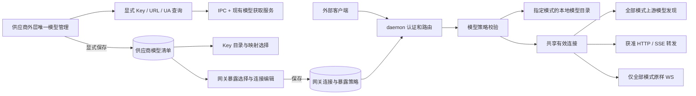

# 技术设计：独立外部网关、统一模型入口与日志留存

状态：上一轮实现已在工作区，任务记录为 `in_progress`。2026-10-29 最新三项用户选择已合入：供应商外层唯一模型管理入口、网关展示与调用双重限制、无法验证即拒绝；默认 Bearer 的原确认保留。以下是等待最终摘要后明确批准的设计，不是实施结果。当前未改产品代码或启动任务。需求见 [prd.md](<.trellis/tasks/10-28-gateway-console-provider-ux/prd.md>)，证据见 [research.md](<.trellis/tasks/10-28-gateway-console-provider-ux/research.md>)，执行见 [implement.md](<.trellis/tasks/10-28-gateway-console-provider-ux/implement.md>)。

## 1. 目标、边界与关键决策

| 领域 | 设计决定 | 必须保留的行为 |
| --- | --- | --- |
| 外部网关 | 独立连接 + 持久化暴露策略；默认全部，指定模式严格校验 | 本地 token、名称、绑定、启停、显式连接；允许的请求不改 model |
| 模型管理 | 供应商外层一个获取窗口；持久化清单供映射/网关读取 | 获取不自动选择/保存；模型清单、Key 草稿、网关策略分别提交 |
| 控制台 | 请求使用真实 Table；日志/统计/控制台独立入口，异常是请求筛选条件 | 请求生命周期合并、详情、复制、历史恢复 |
| 日志 | 三个事件来源、两个文件所有者；本地自然日 TTL 叠加容量保护 | 有界异步写入、脱敏、生产日志等级、统计数据库 |
| 菜单 | 固定打开并聚焦窗口；紧凑的管理/网关/观测入口 | 当前路由、页面草稿、仅菜单栏常驻 |
| 供应商线路质量 | 保留真实绑定归属和按 scope 刷新 | 既有 provider/Key 统计口径、计量和历史记录 |

不新增 ClientKind、依赖、服务器或独立模型页面，不修改 DSH，不引入网关模型重写、协议转换、跨供应商故障转移或 Azure Responses 重试。严格模式未知协议先拒绝，不把原样 WS 透传误当成已验证。内置客户端目录、角色、1M、启动和映射语义仍由原模块负责。

## 2. 分层与复用



- 复用已存在的 [网关连接解析](<src-tauri/src/shared_runtime/gateway_connection.rs>)、[模型获取服务](<src-tauri/src/services/model_catalog.rs>) 的地址/头/认证校验、分页、限量和快照转换。它们已经下沉到共享层，本轮不再“重新提取”或复制解析器。
- 新增纯模型策略校验放 Tauri-free shared runtime；命令负责读取/校验/提交，网络 await 前释放 DB 锁。代理在出站前执行策略，拒绝仍进入原请求生命周期。
- 新模型清单按 provider 持久化；renderer 使用一个 Zustand 领域 store，查询控制器只拥有本次获取状态。模型映射和网关可读取清单 IPC，但不能调用云端获取接口。
- Key 表单、供应商模型管理、网关编辑各自拥有草稿和保存边界；不把模型清单保存伪装成 Key 保存。`consoleStore` 与持久化桥生命周期不变。

## 3. 网关数据契约与迁移

第 3.1–3.2 节是已有连接契约及原一次性迁移的历史设计，工作区已有实现，不在 R9 重跑；本轮仅新增第 3.3 节的暴露策略。

### 3.1 持久化和 DTO

拟定 IPC 类型（字段名与 Rust serde camelCase 同步）：

```typescript
type GatewayConnectionConfig = {
  baseUrl?: string | null
  authScheme: 'bearer' | 'x-api-key' | 'none'
  userAgent?: string | null
}
```

- `proxy_sessions` 新增 `gateway_connection_config TEXT NULL`，内容为上述 JSON；CREATE、ALTER、全部相关 SELECT/mapper/INSERT/UPDATE、Rust/TS 模型与 fixtures 一起更新。
- `ProxySession.connectionConfig` 可缺失/null；非 gateway 行保持 null。`Gateway.connectionConfig` 对外返回已归一化对象，默认 `{ authScheme: 'bearer' }`。只把真正的 SQL NULL 解释为旧默认，损坏 JSON 不静默降级。
- `baseUrl` 和 `userAgent` 的空串/null 归一化为未覆盖；`authScheme` 始终显式。保存完整 connectionConfig 对象，避免 Option 无法区分“保持原值”和“清空字段”。
- 更新请求省略整个 connectionConfig 表示保持；传对象表示整体替换。恢复供应商地址发送 `baseUrl: null`，清 UA 发送 `userAgent: null`；认证重置为显式 Bearer。新建旧调用方省略对象时用新默认。
- 网关绑定变更不复制新 Key 的 clientConfigs，已有网关覆盖仍属于该网关；编辑器显示当前有效地址与绑定，用户可显式恢复默认。

### 3.2 一次性迁移

当前 schema 没有网关连接列；旧转发读取的是绑定 Key 的 `clientConfigs.claude_code`。兼容只在升级事务内拍一次快照，运行时不再动态继承：

1. 添加列后，用 `migration.gatewayConnectionConfig.v1` 标记保护事务；只处理 `session_kind='gateway'` 且新列为 NULL 的旧行。
2. 初始为 Bearer/供应商地址/无 UA 覆盖；从旧 Claude Code 连接对象复制显式非空的 baseUrl、proxyUserAgent 和合法显式 authScheme。复制的是旧转发实际使用的来源，不采用旧查模优先 Codex/Grok 的分支。
3. 不复制查询 UA 偏好、默认认证猜测、模型映射、角色或启动参数；既有新列非 NULL 的值不覆盖。
4. 历史 URL/UA 字符串保留供修复，不因为旧值不合法而阻止整个应用升级。使用/重新保存时执行校验并返回可定位的错误；不回退到另一客户端地址。损坏 JSON 的数据库错误不得包含原始 JSON/秘密。
5. 更新列及 marker 在同一事务提交；失败整体回滚。重跑、新装、无网关、多客户端 Key、已有独立配置均有测试。

只改变该网关连接列；名称、token、绑定、启停和 Key/provider 内容逐项断言不变。没有显式配置的旧网关会采用新的 Bearer 默认，这属于消除隐式认证猜测的兼容变化，需写入 CHANGELOG；已有显式 x-api-key/none 被保留。

### 3.3 本轮增量：模型暴露策略

```typescript
type GatewayModelPolicy =
  | { mode: 'all' }
  | { mode: 'selected'; modelIds: string[] }
```

- 在 `proxy_sessions` 增加独立 `gateway_model_policy TEXT NULL`，不塞入连接配置或 clientConfigs。CREATE/ALTER、所有 gateway/session SELECT/mapper/写入、Rust/TS DTO、IPC 和 fixture 一次接通；非 gateway 行保持 NULL。
- 旧 SQL NULL/新建省略策略为 all；更新省略表示保持原策略；恢复全部必须显式提交 `{mode:'all'}`。selected 要求非空、有效且去重的真实 ID；拒绝空 selected、未知 mode、坏 JSON，不能降级成 all。
- Gateway 对 UI 返回归一化策略。保存连接与策略使用同一事务、只更新该网关；保留 token/名称/绑定/启停/连接。绑定变更保留现有策略并提示复核，不从新 Key 复制配置或自动放开。
- 策略只保存 ID 集合，不保存角色、1M、默认模型或映射。供应商清单刷新/删项不修改策略；已选缺失项以 ID 兜底可见，显式保存网关才调整。

## 4. 网关有效连接、界面与访问控制

### 4.1 连接优先级

| 值 | 获准上游请求统一规则 |
| --- | --- |
| 上游凭据 | 绑定 Key 的 value；保留归属、启用、耗尽和 session 状态校验 |
| Base URL | gateway.baseUrl 非空覆盖，否则 provider.baseUrl |
| 认证 | gateway.authScheme；不按 model、URL 或内置客户端猜测 |
| UA | gateway.userAgent > 入站 UA > provider 的 UA 默认 > 应用模型查询 UA |
| 普通 Header | 入站值优先；供应商只补缺，名称大小写不影响优先级 |
| HTTP Proxy | provider.httpProxy，实际模型获取与 HTTP/WS 共用 |
| model / Body | 校验通过后保持原样，不执行别名解码、映射或协议转换 |

UA 最后一项仅适用于没有入站 UA 的主动模型获取，普通转发不强制生成查询 UA。供应商 UA 默认仍来自 requestHeaders，不新增字段；网关不读取 `model-catalog-user-agent.<provider>.<client>`。内部有效连接含凭据，不 Debug/序列化给 UI。

### 4.2 URL、Header 与目录发布

- 保存/独立模型查询/运行时复用 HTTP(S) URL 校验：合法 host/port，可含路径前缀；拒绝内嵌凭据、query、fragment，不回显完整错误 URL。普通请求自身 query 保持，策略先检查歧义；获取分页参数仍由原服务生成。
- 复用既有 URL 构造和 `/v1` 合并规则，保留 IPv6、尾斜杠、路径前缀回归。

| Base URL 路径 | 客户端路径 | 上游路径 |
| --- | --- | --- |
| `/` | `/models` 或 `/v1/models` | `/v1/models`（仅全部模式上游发现） |
| `/v1` | `/responses` 或 `/v1/responses` | `/v1/responses` |
| `/relay` | `/chat/completions` | `/relay/v1/chat/completions` |
| `/relay/v1` | `/v1/chat/completions?x=1` | `/relay/v1/chat/completions?x=1` |

- 全部模式的模型发现沿用真实上游目录、分页/去重/空结果/失败语义，保留 10 页、10,000 模型、8 MiB/页、15 秒限制。
- 指定模式的 `/models`、`/v1/models` 及已有发现别名直接发布配置的 ID 集合，名称可取供应商清单，缺失名称以 ID 兜底；不再查询上游、补入未选模型或让上游空结果清掉已选项。它是显式暴露清单，不是上游权限证明，不生成默认模型。
- 外部发现也必须先通过网关 token、启停及绑定有效性校验；本地目录不是管理面旁路。模型查询和非推理发现不伪造计费推理。
- Header 顺序仍是过滤受保护/逐跳头 → 补供应商普通头 → 设网关认证 → 最终 UA。处理 Connection 动态逐跳字段及 WS 保留头；供应商不能注入凭据、Host、Content-Length、Proxy-Authorization 或逐跳/握手头。
- Bearer 只送绑定 Key 的 Authorization，x-api-key 只送相应头，none 均移除；本地 token 不出站。`{{baseUrl}}` 使用网关有效地址，内置客户端模板语义不变。
- 获准 HTTP/SSE 与全部模式 WS 沿用原传输/取消/计量；策略读取/校验不重写 Body/model，不把发现服务变成推理协议转换器。

### 4.3 命令与界面

| 接口 | 本轮变更 | 副作用 |
| --- | --- | --- |
| gateway_create / gateway_update | 在现有 connectionConfig 外增加可选 modelPolicy | 仅显式保存写该网关 |
| gateway_list / session 读取 | 返回并传递模型策略 | 只读；坏数据不作为全部 |
| provider 清单读取/保存/独立查询 | 第 5 节的独立契约 | 只有清单保存持久化；查询不改 Key |

删除网关表单和二级菜单的模型预览、自动请求和相应状态链路；仅服务旧预览 UI 的命令/API 经调用点核对后一并退役，不误删外部客户端使用的发现服务。接口/注册/fixtures 作为同一变更单元，网络 await 前释放 DB 锁。

基础表单：名称 → 供应商/Key → Base URL（默认提示/恢复）→ 暴露全部或指定模型。指定时展示已保存供应商清单与既有已选 ID，支持搜索/勾选，不包含刷新/获取/预览。无清单提示去外层管理；全部模式无需查模即可保存。认证和 UA 放高级设置，新建 Bearer，已有非默认覆盖可见且不重置。卡片保留必要操作、暴露摘要和故障提示，移除两段长说明。

### 4.4 指定模式的最小安全边界

策略校验放 Tauri-free shared runtime，代理统一执行，不能只在某个 POST 分支或前端筛选。默认 all 继续原行为；selected 使用封闭端点集合和明确的模型识别，未支持即拒绝。

| 请求 | selected 行为 |
| --- | --- |
| 已有模型列表路径 GET | 本地发布且仅发布配置 ID |
| 已知 JSON POST：`/chat/completions`、`/completions`、`/responses`、`/responses/compact`、`/messages`、`/messages/count_tokens`、`/embeddings`、`/rerank` | 仅这些端点及其已核对的 `/v1`/客户端路径别名；严格读取唯一字符串 model，与允许集合精确匹配后原样转发 |
| SSE | 与相应 HTTP 请求共用上游前校验，不待流建立才判断 |
| WS/其他 Upgrade、CONNECT | 连接上游前拒绝；本轮不解析不透明消息来猜模型 |
| 其他方法/端点、资源句柄/批处理、无法验证的 multipart/二进制/压缩体 | 明确拒绝，不通过无 model 路径转发 |

- 不用前缀/模糊/忽略大小写匹配 ID，不把别名、家族、默认值或缺省 model 当成获准模型。重复 model 字段、非字符串/空值、无效 JSON、多来源歧义均拒绝；沿用请求体大小保护。
- 路径识别与上游构造基于同一有效路径；未知/混淆编码、重复路径段、额外方法不能落入“未识别就透传”。测试必须覆盖所有已有发现/推理别名、query 和替代路径。
- 未选模型返回本地 403；格式错误按 400/现有体积错误处理；不支持且无法验证返回明确策略拒绝。错误不泄露 token/Key，记录为原控制台拒绝生命周期，不能伪装上游成功或计费推理。
- 请求的授权点读取最新持久化策略，不把旧 all 缓存在进程中长期使用。all 下已经建立的 WS 在每个客户端应用帧转发前重新核对最新策略；改为 selected、策略损坏或网关撤销后关闭（策略违规），新帧不得到达上游。无需为此解析 WS 内容，也不能只限制新握手。
- 授权前已经放行的 HTTP/SSE 允许正常结束；保存后进入的新请求/WS 应用帧遵循新策略。策略 DB 读取失败关闭/拒绝，不能 fail-open。
- UI 明示指定模式暂不支持原样 WS 等无法验证的形式；不承诺本轮补齐协议。全部模式的 WS 文本/二进制、协商、取消和传输错误回归保持。

## 5. 供应商唯一模型管理与下游选择

### 5.1 入口、查询与三个保存边界

供应商外层“查看模型”改为独立“模型管理”窗口；移除打开 Key 编辑的跳转和菜单里的 Key 子菜单。单 Key 可预填但显示实际选择，多 Key 在窗口内选择。必需的查询上下文是已保存 Key、可编辑/恢复供应商默认的 Base URL、UA；高级区显式选择认证，初始采用 Bearer，可切换 x-api-key/none，不猜测内置客户端。复用现有 UA 预设/校验能力，不把旧客户端查询偏好自动写入这里或转发配置。

| 编辑器 | 草稿 | 显式保存的对象 |
| --- | --- | --- |
| 外层模型管理 | 查询参数、本次候选、拟保存清单/手动项 | 该供应商的模型清单，不是 Key/clientConfigs |
| Key 目录/映射 | 客户端目录策略、选择、映射及原连接字段 | 子视图应用只改外层 Key 草稿；Key 保存才持久化 |
| 网关编辑 | 绑定、连接、暴露集合 | 该网关；不改前两者 |

- 查询、URL/UA 应用、刷新均不写任何配置；独立窗口的保存只保存模型清单。关闭查询窗口使在途结果失效。
- 没有保存过的 Key 时可手动管理清单，但获取按钮不可用；不再从 Key 编辑草稿提取凭据发查询。原 Key 连接草稿的保存/取消/恢复能力不变。
- 模型映射、Key 模型选择和网关删除查询按钮、UA 查询区和自动获取逻辑，读取共享清单即可；不新增从这些页面发起获取的捷径或第二个管理窗口。
- “单入口”限制管理 UI 的主动获取，不取消外部客户端 `/models` 或内置客户端既有运行时目录协议。

### 5.2 持久化清单与查询身份

新增 `provider_model_catalogs`，作为 provider 的一对一扩展，外键删除级联。独立 DB 模块负责 GET/显式保存；字段包含 provider_id、模型 JSON、revision、updated_at。旧数据库通过幂等 CREATE 新表得到空清单，不从某把 Key 的目录/角色隐式迁移、不改变 clientConfigs/modelMapping。

- 保存的是有界、按真实 ID 去重的 `ClientModel[]`（保留 displayName/supports1m）；不保存凭据、请求头或含秘密的缓存身份。查询参数默认属于当前窗口，实际地址/Key 别名在当前查询状态中显示，不谎称所有保存模型都被每把 Key 验证可用。
- getter 返回 `models/revision/updatedAt`；保存携带读到的 revision，事务内更新，冲突提示重新读取而非覆盖其他窗口的新清单。空清单允许保存，但不会清空任何 Key 或网关配置。
- 通过 `getApi().provider` 原子接通清单读取/保存与独立模型查询命令，查询输入为 providerId、apiKeyId 和显式连接草稿，不要求 clientKind，不传一份伪造的 clientConfigs。后端重新校验 Key 归属并读取凭据，复用既有模型服务/连接头策略。
- Zustand 领域 store 按 providerId 保存已读取清单、revision、加载/错误状态；成功保存发布新快照，下游订阅读取。未保存勾选不写全局 store，不用 localStorage 保存领域数据。
- 查询控制器继续使用有界短缓存（32 身份/5 分钟）及在途去重，但它不是模型清单。有效身份包括 provider/Key、凭据版本、有效 URL、auth、UA、provider headers/proxy，不再靠隐含 clientKind 决定路由；秘密不进日志/缓存键明文。
- 状态为 idle / missingCredential / loading / ready / empty / error；响应提交比较 identity、递增 revision 和存活状态。Key/URL/UA 改变立即废弃旧请求；应用字段值直接查询，不依赖未提交的 React state。
- 失败可展示同身份的过期成功结果并标记，不能把别的 Key/地址的旧结果冒充当前查询；刷新、空结果、取消不清掉已保存清单或手工条目。

### 5.3 候选、已配置选择与目录策略

外层管理提供名称/ID 搜索、勾选、已选计数/列表、仅当前搜索结果的批选和手动 ID/名称输入。获取只替换该身份的临时候选，显式保存才更新模型清单。已保存但新结果没有的 ID 保留并标记；空白、URL 误填和重复 ID 校验复用现有模型工具。

Key 的客户端目录选择读取清单 + 当前 Key 草稿条目，不再含获取按钮。原 provider / append / custom 语义保留，但不再用模式锁住选择入口或在确认时丢弃用户刚选的模型：

| 显式应用动作 | 策略 | 保存语义 |
| --- | --- | --- |
| 使用供应商完整目录 | provider | 继续沿用原运行时供应商目录，不把管理清单强行当作完整上游目录 |
| 保留供应商并补充 | append | 保留原供应商目录和显式增补 |
| 使用所选模型 | custom | 使用明确选中的模型，不受后续清单刷新影响 |

选择与应用策略分开；顶部显示当前模式和将产生的影响。搜索/批选/手工输入不静默改变 forwardMode、目录策略或启动参数。子视图应用只更新当前 Key 草稿，外层取消不写后端；已明确保存的供应商清单不会因此被撤销。

### 5.4 可搜索映射目标

- 候选来自已保存供应商清单、当前 Key 草稿/手工模型和字段已有 ID，不调用 query hook 去获取云端模型。
- 区分客户端目录与上游映射候选；custom 目录不能成为映射目标白名单。清单删项、读取失败或刷新不能使已保存映射值消失。
- 固定 upstreamModel、haiku/sonnet/opus 家族目标、分类模型统一使用可搜索 Select；value 是真实 ID，名称与 ID 均可辨认，仍可显式输入未列出的 ID。
- 复用 [CodeModelField.tsx](<src/renderer/components/keys/CodeModelField.tsx>) 的搜索/手动选择模式，保留 inherit/null/client-default/alias 语义，不把所有启动字段改成普通字符串。
- 从当前受控外层草稿计算选项，目录子视图应用后立即可映射；不只读已保存 Key snapshot。角色、supports1m、无关映射及启动字段逐项回归。

## 6. 控制台表现与投影

- 控制台请求改为真正 antd Table：时间、结果（含 HTTP）、模型（含 Auto）、供应商/Key、耗时、原因及明确详情入口。使用投影稳定 key，不用索引；表头/单元格语义、键盘可达、长内容省略/查看与主题 token 一起实现。
- 保持当前时间顺序、尾部跟随、用户上翻暂停及新事件提示/回到最新。实时有界窗口不引入分页或服务端分页；Table 改变滚动节点后重新接好跟随，不把统计账本分页照搬过来。详情保持现有按需侧栏、概要/请求/响应与复制/Escape；筛选隐藏一行不会删除完整投影或选中详情。
- 筛选是“仅异常”、状态和关键词的交集。rejected/cancelled/upstream_error 或 HTTP >=400 均异常；历史 kind=ok 且错误状态不能变绿，pending/WS 不算完成成功。
- `/logs` 保留现有终端日志样式与单行/全文详情，显示本地时间、级别、daemon/app/renderer、target 与正文；级别/来源/关键词取交集。warn/error 日志不混入请求。
- `/console` 与 `/logs` 使用固定页面模式和共用小组件/hook，不重复创建 store 或采集。ActivityPage 是无 Tabs 的公共壳，持有请求/日志各自会话筛选，来回切页不丢；离开整个观测区仍按原路由卸载，不新增持久化设置。仅可见页注册 usePageRefresh，刷新数据不清筛选。
- “详细模式”继续是请求捕获开关，放请求页；切路由/关详情不改变 daemon 采集状态。清空仍是全部请求与运行日志，确认文案明确全局范围，并保留部分来源失败提示；不把它伪装为当前页清空。
- `consoleStore` 按 requestId 合并生命周期、按 log.id 去重，终态不被 pending 覆盖，缺失详情不抹掉已有详情；无 ID 的旧记录用 source:epoch:seq 补位。统计页独立数据库账本、分页和详情不变。
- 内存维持既有 500 条/8 MiB 合并上限与近三个本地自然日；无事件也检查过期，visibility/focus 恢复检查。UI 保留有界窗口、截断/丢弃、历史/状态读取失败、离线与写入失败提示，不承诺列出了三天全部数据。

## 7. renderer 持久化桥与日志 IPC

### 7.1 事件和批次

`main.tsx` 安装 console tap、进程级 store 及持久化桥；不依赖 Console 页面 mount。console.log 归 info，其余维持现有等级；Rust app/daemon 继续 Info 上限及 cc_use target 过滤，不开启依赖库 debug/trace。

- renderer ID 改为 `renderer-<启动随机 epoch>-<递增 seq>`，页面刷新更换 epoch；实时事件和落盘使用同一 ID。
- renderer 源在 UI 中仍为 renderer；文件归属为 app。只有 daemon-* 与 app-* 两类文件，第三个事件来源不形成第三套 50 MiB 预算。
- 新增 `console_log_append_renderer` / `Api.console.appendRendererLogs`，输入为专门的 renderer log DTO 数组，不接受 request 事件或可伪造的任意 ConsoleEvent。
- 初始限额：每批最多 50 条、序列化 UTF-8 总量 64 KiB、单条正文最多 16 KiB；本地缓冲最多 1,000 条且总量不超过 1 MiB。每 500 ms 或达到批次边界 flush，仅一个 IPC 在途，不给每条 console 创建 Promise。
- 后端再次校验 ID、UTC timestamp、等级（error/warn/info/debug）、target/正文类型及长度，强制 source=renderer，进行脱敏并通过现有 app writer 的 try_send 入队。超大整批拒绝；批内非法项计 rejected，其余合法项照常校验入队。返回 accepted/rejected 数量只表示入队结果，不承诺磁盘成功。
- 后端不再次广播该批次；renderer 已实时展示，回放按同 ID 合并。桥只订阅 renderer bus，不能把从 Tauri/SSE 回放的 app/daemon 日志再送回持久化。

### 7.2 失败、清空和状态

- 入队失败、磁盘错误、前端队列溢出、IPC 拒绝分别计数；有限缓冲超过上限淘汰最旧待写项。IPC 失败不无限重试，丢弃该批并记录本地失败数；不通过 console.*、log::* 或同一事件总线报告失败。
- logStatus 扩展为 app/daemon 可区分的 dropped、写入失败、截断和保留策略信息；daemon 状态通过既有 management log-status 查询，离线标 unavailable，不能当作 0。UI 同时展示 renderer 本地未送达计数。
- 清空先提升前端写入代次、丢弃尚未发送的旧批次、等待当前批次 settle，再让 app/daemon writer 分别清自己的历史并确认结果。清空期间新日志进入下一代有界缓冲，清空完成后再发送，避免删除后旧批次复活。
- generation 只表达用户显式清空；日切/容量维护不伪装成整库清空。扩展各所有者 generation 后由读取端组成稳定全局代次；兼容旧 meta.json，不能因 app/daemon 并发写而丢失清空标记。
- 若一个所有者清空失败，返回并展示分来源结果，不把“任一成功”报告成全部成功；不改统计数据库。

## 8. 三天留存、轮转与并发安全

### 8.1 时间语义

旧 record.at 和 event.timestamp 均为 **UTC `YYYY-MM-DD HH:MM:SS`**，并非本地时间。保持格式兼容，禁止在 JS 中按本地无时区字符串直接解析。

保留条件：将事件 UTC 时间转换成当前系统时区后，所属自然日为 today、today-1 或 today-2。物理文件清理使用同一记录事件时间，历史过滤和内存投影也相同；record.at 仅为旧记录缺失事件时间时的回退。无效或异常未来时间作为损坏/异常数据计数并跳过，不能永久绕过 TTL。

维护检查保存 localDate 和当前 UTC offset；启动补扫，在 writer 后台循环中每至多 30 秒重新读取日期/时区，日期或 offset 变化时维护，并在每次 append 前检查。持续高流量也不能饿死检查。睡眠期间无法运行；唤醒后第一个检查/append 补做，不用固定 24 小时 sleep 推算午夜。长时间无请求、窗口隐藏也正常执行。

### 8.2 文件所有权和维护顺序

1. app/daemon 各自维护本来源；读取不取得删除权，app 不直接清理 daemon 文件。启动获得同 source writer 所有权后不复用旧进程活动文件，避免把新旧日期混写。
2. 日切先 flush/关闭本来源 active，再创建新 active；closed 文件逐条按时间过滤，全部过期则删除，混合文件通过同目录唯一临时文件写入保留记录后原子 rename。不改记录 ID/epoch/seq，也不重排生命周期。
3. 对旧混合日期文件不能只用 mtime 或文件名判断是否过期；损坏行跳过并计数。读盘端也过滤 TTL，因此物理补扫尚未完成时不会回放过期内容。
4. 清理、轮转、clear 与共享元数据读改写采用同一个跨进程目录维护锁；可复用现有 libc 在 macOS 封装 flock，不新增 crate。进程内再序列化线程访问；锁按固定顺序获取。元数据采用唯一 temp + 原子 rename，避免当前固定 meta.json.tmp 互相覆盖。
5. append 本身不持目录锁；代理只 try_send，维护和读盘在后台/阻塞任务运行。历史读取持维护读锁构造一致快照，有限读取期间可以延后维护，但不能阻塞请求转发；锁失败作为维护状态可见，不回写日志通道。
6. 来源容量只淘汰本来源 closed 文件；维持 10 MiB/文件、最多 5 文件（含 active）、50 MiB/来源。两种文件所有者合计不超过 100 MiB 的常规日志预算，因此无需跨来源删除别人的活动文件。临时整理文件最多增加一个文件的短暂空间，失败时保留原文件并清理 temp。
7. 本来源 active 不因 TTL/容量被直接 unlink；单记录继续遵守 256 KiB 上限和详情降级截断。先执行 TTL 再容量淘汰，所有计数使用有界元数据，损坏元数据不包含原始日志内容。

### 8.3 状态契约

保留 readRecent 的 generation/records/truncated，追加可兼容缺省的 retention 信息：保留起始本地日期、容量淘汰/记录截断/损坏行标志、当前读取是否受 limit 限制。`truncated` 继续表示结果不完整，不能只凭文件数达到 5 推断已丢数据。

writer 维护 dropped、writeFailed、trimmed、capacityEvicted 等独立计数；旧总 dropped 入口兼容。容量淘汰标志需持久到来源元数据，应用重启后仍能解释恢复窗口不完整。TTL 正常过期与异常磁盘失败分开呈现。

## 9. 菜单与导航

- tray 第一项文案固定“打开主界面”，回调调用现有 show_main_window：show → unminimize → focus；不导航、不重建窗口、不 toggle。窗口隐藏/最小化/失焦/已打开四种状态均验收。
- 不改 Dock/accessory 策略；保留已有 30 秒今日用量刷新和 macOS 空字符串清标题行为。用量刷新与日志 TTL 使用各自职责，不删除 request_logs/usage_logs。
- Sidebar 保持网关在管理/观测之外独立，但使用普通条目的紧凑间距，不叠加 25px wrapper 间距或额外面板 padding/border；折叠/窄窗口同样处理。观测入口为用量统计 `/stats`、控制台 `/console`、运行日志 `/logs`，移除内部重复 Tabs。ActivityPage 仅负责统一页头、会话状态与 Outlet；TitleBar、路由标题、中英文案与精确高亮一起更新，原深链保持。

## 10. 网关请求与供应商线路质量（R7）

### 10.1 数据源与最小修补边界

现场已补充定位：DSH 名为 any-router 的配置实际使用 agentRouter 网关 token；anyRouter 默认近一周无记录、近一月可显示历史。因此首次空状态在这一现场是正确查询结果。下述刷新/错误态属于独立缺口，不能冒充此现场根因；不自动改 DSH 凭据，也不把 agentRouter 的记录搬到 anyRouter。

```text
HTTP/SSE 网关推理 → 绑定 providerId / apiKeyId → LogContext
  → 现有 request_logs → getResourceStatistics → 详情“线路质量”
Console 终态事件 → 异步 gateway_request_events → 卡片近 24 小时成功率
```

源码不存在统一排除 gateway 的资源统计条件，现场只读聚合也已发现有归属的记录。因此实施先用真实 handler/mock 响应驱动 request_logs，再调用现有资源统计查询，证明遗漏在哪层；不能直接把请求再写一遍来“补统计”。

- 归属只取请求开始时解析的 session/绑定 providerId/apiKeyId；后续切换网关绑定不能使已完成旧请求改记新供应商。已有名字快照用于显示，不用名称代替稳定 ID。
- HTTP 带 usage 的成功、HTTP 错误、传输失败、SSE 完成/失败/取消沿用原 outcome 与记录策略，按 request_id 验证唯一性；终结 guard、stream EOF/Drop 和事件处理不得重复写同一请求。
- token/缓存/TTFT 使用已有 parser 和实测值；缺少测量显示空值，不以 0 或虚构 usage 生成成功样本。成功 /models 等非推理请求不写成计费推理；HTTP 成功无 usage、WS 仅握手的现有边界单独测试和说明。
- 两套统计不做无条件 UNION 或相加：request_logs 的质量分母含原 outcome 规则，gateway_request_events 排除 cancelled/local rejected 等规则继续保留。卡片与详情的窗口/含义不同，刷新和数值不得互相冒充。
- 仅当端到端测试证明具体 handler 分支缺失记录时补该分支，优先复用已有 record_usage/终结机制。聚合或 IPC 有问题则修对应层，不新增重复表，不扩大到通用 WS 推理帧统计，不回填无法证明归属的旧数据。

### 10.2 弹窗查询与刷新

`ResourceUsageModal` 抽出同一 load 方法供打开/范围变更与 usePageRefresh 调用；只在 open 且 scope 有效时请求。不从余额刷新或 provider metrics 的成功回调假装更新此弹窗，也不触发上游余额/模型查询。

- 查询身份是 scope.type + providerId + apiKeyId + timeRange；view=usage/quality 是展示状态，刷新不得重置选中的视图或范围。
- 请求启动时增加 revision，响应和 finally 只有在相同身份、revision 且仍打开时可提交；关闭/切换 scope 使旧结果失效。
- 同身份刷新保留旧数据但展示 loading；刷新失败显式显示错误和重试，若展示旧数据需标明未更新。新身份先清除旧数据，不能在另一个供应商的错误态展示旧统计。
- 空结果仅由成功返回且 totalRequests=0 确认。IPC/DB 失败不能落入同一个 noData Empty。
- 通过注册到现有页面刷新机制支持用户刷新已打开弹窗；不引入第二套轮询/查询缓存框架，也不承诺每条请求完成后同步实时更新。

### 10.3 验证

T21：从本地上游返回真实 HTTP/SSE 结果，消费/终结响应后读取 request_logs 和 provider/Key 资源统计，核对计数、成功率、延迟、usage 和唯一归属；同时发同 Key 双网关、不同 provider/Key 及绑定切换场景，确保互不污染。该用例首先定位是否另有落盘遗漏，不预设请求必须在旧实现失败。

T22：从供应商菜单首次打开真实 ResourceUsageModal 容器，验证传入点击供应商的 providerId；有记录显示统计、成功空响应显示范围为空。再模拟新统计可用并执行 refreshCurrentPage，验证 scope/range、新数值、视图保留、旧响应隔离和失败重试。后半组预期暴露当前未注册刷新与失败误显示无数据的问题，不要求正确的首次空响应失败。

## 11. 验证、交付与回滚

| 验收 | 主要证据 |
| --- | --- |
| A1/A7 | 窗口四状态手工验收；tray 已有日切用例及显示归零回归；统计表不变断言 |
| A2/A11/A15 | 网关/导航组件测试；实际路由直达；旧网关迁移前后 token、绑定、启停比对 |
| A3/A4 | 列表状态/异常组合筛选、历史 4xx/5xx、日志组合过滤和详情复制 |
| A5/A6/A7 | 临时目录和注入时钟；renderer IPC、进程重启、空闲/持续流量日切、UTC/本地边界、旧混合文件、并发读写/清空、损坏行和容量保护 |
| A8/A9/A10 | 唯一获取窗口的 Key/URL/UA 与延迟身份隔离；清单保存/重开/下游只读；无凭据/空/失败、候选不自动保存、手工项与旧 Key 配置保留 |
| A13/A14/A15 | 全部模式的原连接/发现/HTTP/SSE/WS 回归；指定目录与允许集合一致，已选原样转发、未选/未知/WS 上游零命中；运行中策略变更和不同网关隔离 |
| A12 | 类型/契约测试、lint、相关与完整测试、构建、Rust fmt/clippy、中英文及秘密脱敏检查 |
| A16/A17 | handler→落盘→供应商/Key 资源统计端到端验证；打开弹窗后页面刷新、范围/视图保留、错误与空状态、延迟结果隔离 |

关键测试先证明现有分流问题，再验证修复；不使用真实用户 Key，不运行生产 daemon。文件维护并发测试必须包含两个独立 writer/进程语义，不能只靠单线程 sleep。设计中的数值为实施默认，任何改变须同步常量、契约和测试。

代码分阶段交付但在同一任务内集成，顺序见 [implement.md](<.trellis/tasks/10-28-gateway-console-provider-ux/implement.md>)。新表/列仅增量添加，旧数据保留；回退不 DROP 表/列、不回填 Key/provider、不恢复已按策略删除的日志或图标。旧二进制可能忽略模型暴露策略，启用限制后降级必须先停用相应网关，不能承诺安全热降级。正式升级/安装/重启仍由用户另行要求。

真实 DSH 桌面、窗口焦点和跨午夜桌面行为若未操作，只能报告 mock/自动化证据及待验步骤。当前仍无实施或新增测试结果；research.md 的 19 个测试是上一轮基线，不是本设计验收。

## 12. 局域网访问（R8，2026-10-29 续接新增）

### 12.1 设置与绑定

| 项 | 设计 |
| --- | --- |
| 设置字段 | `GlobalSettings.proxyListenScope: 'loopback' \| 'lan'`（Rust `proxy_listen_scope: String`），持久化为 settings key `proxyListenScope`；缺失/非法值按 `loopback` 处理，无 schema 变更 |
| 绑定 | `loopback` → `127.0.0.1:<proxyPort>`（默认，行为与现状一致）；`lan` → `0.0.0.0:<proxyPort>`（所有 IPv4/IPv6 接口监听；IPv6 入口本轮不展示） |
| 生效 | 修改后必须重启 daemon；`settings_update` 检测 scope 变化，与 `proxyPort` 走同一自动重启路径，失败 log + 状态回读，不静默回滚设置值 |
| 兼容 | 升级后无该 key = 仅本机；关闭 LAN 立即回到仅本机；回滚旧二进制会忽略该设置（旧版仍只监听回环） |

### 12.2 管理面隔离（硬约束）

- 所有 `/_management/*` 路由（health、detail-mode、instances、console SSE/clear/log-status）只接受 loopback 对端。
- 判定来源：`ConnectInfo<SocketAddr>`（daemon 使用 `into_make_service_with_connect_info`）；`ip().is_loopback()` 为真才放行，否则 403，且不返回任何内部细节。
- 缺少 ConnectInfo 只可能出现在进程内 router 测试/直连场景，按可信处理；真实监听器总有 ConnectInfo，因此在 LAN 监听下无法绕过。测试必须覆盖“非 loopback 403、loopback 200、missing 放行（测试语义）”三类。
- 该中间件独立于设置值：即使误配或未来增加其他绑定方式，management 也不会随代理暴露。

### 12.3 代理面策略

- 非 loopback 对端仅允许 `session-` 本地 Key（含 gateway 行）解析出的请求；`RoutePlan::PassThrough`（provider 真实凭据直连）从非 loopback 返回 403，避免把本机代理变成局域网开放中继。`RejectMissingAuth` 语义不变。
- 网关的透明转发、认证/UA/Header 策略、模型发现、线路质量归属、console/metrics 记录不因来源地址改变；本机 pass-through、托管实例、内置客户端行为不变。
- 不在请求日志/console/错误响应里回显对端 LAN 地址之外的敏感信息；不记录来源 IP 到统计（本轮无需求）。

### 12.4 地址发现与界面

- `shared_runtime::network`：用 libc `getifaddrs` 枚举 `AF_INET`、flags 含 `IFF_UP`、排除 `IFF_LOOPBACK`、排除 `0.0.0.0`/`169.254.0.0/16`/`127.0.0.0/8` 的地址；去重；私网段（10/8、172.16/12、192.168/16）优先排序，其次其他可路由地址；纯函数 `collect_lan_addresses(entries)` 可单测。
- 新命令 `proxy_lan_addresses` → `{ port: number, scope: 'loopback' | 'lan', addresses: [{ ip, url, interface }] }`；只读，无副作用；不返回管理 token/内部路径。
- 设置页：监听范围 Segmented（仅本机/局域网）+ 开启时的安全提示 + 地址列表（复制、网卡名、空列表原因、IPv6 暂不支持说明）；端口/重启入口保持。
- 网关页：每张卡展示本机地址（不变）+ 开启时增加 LAN 入口列表与复制；未开启时给一行可点击跳转设置的提示（不做自动跳转）。不新增每网关开关。
- i18n：zh/en 成对；安全提示必须说明“局域网内其他设备可访问，持本地 Key 即可调用”。

### 12.5 安全与回滚

- 默认关闭；开启是显式用户操作。局域网为明文 HTTP，提示中不承诺加密；macOS 应用防火墙可能首次拦截，提示用户允许或关闭防火墙规则（不自动改系统设置）。
- management token、console 清空、实例管理、SSE 管理流不随代理暴露；LAN 客户端拿不到管理 token 路径。
- 回滚：关闭监听范围即回仅本机；无需数据迁移；`proxyListenScope` 可保留在库中不影响旧版本。
- 验证：T23（设置/绑定/默认）、T24（management loopback 三类）、T25（LAN 网关可用 + pass-through 403 + 回环不变）、E2E 真机 LAN IP 脚本；H05 真实第二设备访问为手工未执行项。

### 12.6 实施偏差记录（2026-10-29）

- 地址收集额外过滤 `IFF_POINTOPOINT`（VPN/tunnel 如 `utun*`）：本机 `getifaddrs` 会列出 `28.0.0.0/utun1500`（P2P 隧道端点的网络地址），对同 Wi-Fi 设备不可达且会误导复制。`lan` 监听范围仍监听这些接口，仅“展示列表”过滤；实现与单测在 `shared_runtime/network.rs::is_advertisable_interface_flags`，已同步 backend spec 与 validation。

## 13. R9 本轮实施边界与自定义图标删除

### 13.1 五项返工的有效设计

本轮实施第 3.3/4 节的网关暴露持久化、严格校验及连接表单，第 5 节的唯一模型管理/持久化清单/映射消费，第 6 节的请求 Table 与日志拆分，第 9 节的紧凑单层导航及以下图标删除。第 3.1–3.2 的旧连接迁移、日志管线、统计和 LAN 为兼容基线，不重复建设。必要的新表/列与策略检查不能省略成前端过滤；完整方案仍须最新摘要之后的明确批准。

### 13.2 图标删除交互

- [ProviderModal.tsx](<src/renderer/components/providers/ProviderModal.tsx>) 的上传图标缩略项提供明确删除按钮，按钮与选择动作分离、键盘可达，内置图标没有删除入口。
- 点击后确认删除资源；在用图标显示供应商使用情况，要求先换图标并保存，再删除，不隐式修改任何供应商/Key。只在未保存草稿中选中的资源可删除，成功后清掉该草稿引用并回退默认占位。
- 删除中只锁定对应操作，避免重复提交；成功后从列表移除并失效 [ProviderIcon.tsx](<src/renderer/components/providers/ProviderIcon.tsx>) 的共享读缓存，更新列表查询代次，旧 list/read 结果不能重新插回已删项。关闭/重开保持一致。
- 取消不发命令；失败保留原选择/列表并显示可理解错误，不先乐观删掉再吞错。删除是独立资源操作，外层取消表单不会恢复已经明确确认删除的文件，确认文案必须说明。

### 13.3 IPC 与文件边界

```text
删除确认 → Api.icon.delete(filename) → icon_delete
  → 读取最新供应商引用 + 安全路径校验 → 删除普通上传文件
  → 成功 / in-use（引用供应商）结果 → 本地化反馈与缓存失效
```

- [system.rs](<src-tauri/src/commands/system.rs>) 使用可测的 inner helper，wrapper 只取状态/目录并调用；[lib.rs](<src-tauri/src/lib.rs>) 注册、[Api 类型](<src/renderer/api/types.ts>)、[API 构造](<src/renderer/api/index.ts>) 和契约测试作为原子单元。需要的结果 DTO 以 Rust/TS 镜像表达成功与使用中，其他 IO/校验失败继续返回错误。
- 前端使用上传列表中的纯文件名，不向删除 API 传 URL 或绝对路径。服务端独立拒绝空值、斜杠/反斜杠、穿越、内置标识和非图片资源；验证解析后的绝对路径严格位于应用图标目录。
- 使用 symlink_metadata 检查普通文件，拒绝符号链接/目录；仅删除确认过的目标，不递归、不通配。测试使用临时目录，不调用真实用户图标目录。
- 服务端在删除前按当前数据库检查所有供应商引用；用统一文件名识别历史绝对路径/file URL，不能只比较原始 icon 字符串而漏检。在适当同步锁内完成引用检查与删除，不跨网络 await 持锁。
- 不增删供应商、不改 Key、不新增数据库 schema；正在使用的资源一律阻止删除。旧缺失图片的显示兜底与新删除后的草稿回退保持一致。

### 13.4 主要风险与验证边界

- 用户常把目录可用模型与映射上游目标混淆，两个候选集合必须分别验证；搜索/刷新不改变已保存值。
- Table 的真实滚动节点和分路由状态是 UI 回归重点；保留详情、跟随/暂停、全局清空语义及 bounded-window 提示。
- 认证不添加 default/auto 后端枚举，不自动继承或重置已有 x-api-key/none。网关没有模型预览；指定模式拒绝无法验证的请求，包括本轮未适配的原样 WS。
- 供应商清单不是所有 Key 的权限证明；已保存配置不能被候选刷新或删项牵连。新策略必须贯穿持久化、运行时和旧 WS 的后续消息，不能只过滤模型列表。
- 图标删除不可逆，以明确确认 + 服务端在用检查限制风险；不承诺外层取消恢复文件。
- 自动测试对应 T27–T31/A21–A25；实际 WebView 明暗主题、窄窗口、折叠和长内容另验，未执行就如实记录。全程不改生产数据、不发布、不重启生产 daemon、不修改 DSH。


### 13.5 实施复核补记（2026-10-30）

- 指定模式的推理路径识别与上游 URL 构造共用 `canonical_inference_path`；40 个已支持端点/前缀组合核对实际 URL 与原始 Body，全部模式保持原透明路径兼容。
- 目录选择与策略分离：provider 模式下勾选保存在 modelMapping 的可选 `catalog.draftModels`，仅用于编辑器重开恢复；append/custom 继续写 `catalog.models`。不能直接把 provider 勾选写成 models，因为旧 Rust 代码会从 models 读取别名直通和 1M 标记。draftModels 不进入运行时目录、别名、角色或 1M 计算，不为 Desktop 自动生成角色。TS 往返和 Rust 三客户端等价断言已覆盖。
- 保存进行中，模型和网关弹窗禁止取消/遮罩/Escape/关闭，避免旧保存完成时关闭重开的新编辑器；失败后恢复可操作状态。
- Console 对旧历史缺失 ID 的记录使用来源/进程 epoch/序号补齐身份，实时匿名行的 key 不依赖数组位置；清空前后都令历史读取代次失效，迟到结果不能恢复已清记录。


## 14. R10 交互收敛设计

沿用当前桌面工具的主题、系统正文与等宽模型 ID，不换品牌/字体。结构上的重点是“常用任务在主层，高级参数与健康细节按需展开”。

- 观测：主工具条以可伸展搜索框开头，后接有名称的紧凑筛选（状态/级别/来源），操作区独立对齐；状态与保留窗口降到安静摘要，失败/截断/丢失仍显式可见。避免 Segmented 多组选项挤成连续按钮墙。
- 网关：独立的基本连接与模型暴露区域；绑定选择在同一组内，模型范围采用易理解的二选一，并有稳定的已选反馈；认证与 UA 高级区保持原值。
- 模型：外层“查看模型”承接全套维护，清单为窗口主体；查询连接/认证/UA按使用频率分层，搜索/批选与手动增删在同一清单上；Key 不重建模型库。
- 本轮只改 renderer 与对应测试/文案，不变更传输/持久化和安全行为。


### 14.1 Key 模型选择边界

用户已明确确认“Key 里只保留选择和映射”。Key 内用紧凑的清单选择替代完整维护子视图：provider/append/custom 仍由显式策略控件决定，所选条目只改当前 Key 草稿；候选为供应商清单与已有选择的并集，旧缺失 ID 不消失。新增、重命名和完整清单维护只在外层“查看模型”。映射字段仍允许手输不在目录中的目标 ID，不把手输映射误当清单新增。已有 role/supports1m/启动配置在未显式修改时保持。

### 14.2 续做最小修复边界

当前工作区已完成三块 UI 的主要结构；此次继续只修复复核发现的兼容/状态/保存边界并补验收，不重写已完成布局：

- [Console](<src/renderer/pages/Console.tsx>)：状态读取错误与既有异常计数是并列信息，不能用互斥分支遮蔽 app/daemon 或 renderer 的丢弃/写入失败。保留最后一次成功状态，仅增加读取失败和重试。
- [modelMapping](<src/renderer/utils/modelMapping.ts>)：解析旧 provider `catalog.models` 时保留 renderer 内的可选 `providerRuntimeModels` 快照；当前选择仍为 `models` 编辑器字段，provider 保存仍写 `draftModels`，另将已有快照写回原 `catalog.models`。新普通选择不能提升为 runtime models；明确给 Desktop 指定角色时只记住所用模型的标签/1M 元数据。provider 重开仅恢复显式角色，不能从 runtime ID 的 family 子串补齐缺失或已清空的角色；append/custom 保持既有推断行为。切到 append/custom 是显式策略操作，仍只序列化当前选择为 runtime models。清空 dormant 选择时若旧快照存在，保留空 `draftModels` 以防重开误恢复旧选择。不增 Rust/IPC/DB/共享类型。
- [网关保存](<src/renderer/pages/GatewayPage.tsx>)：一次写入的 busy 状态必须在重新暴露编辑器前结束，后续列表刷新不能再释放下一次保存的 busy 标记；用延迟首轮刷新、第二轮写入的真实组件回归覆盖。
- [外层模型窗口](<src/renderer/components/providers/ProviderModelModal.tsx>) 向 [清单组件](<src/renderer/components/keys/ModelCatalogManager.tsx>) 传递保存忙碌状态，禁用增删、选择、重命名、1M 和手动输入；只读搜索可继续。保存失败后原草稿恢复可编辑，成功后按原流程关闭。
- 对应 [Console 回归](<src/renderer/pages/Console.component.test.tsx>)、[映射工具回归](<src/renderer/utils/modelMapping.test.ts>)、[Key 组件回归](<src/renderer/components/keys/KeyEditModal.component.test.tsx>)、[清单回归](<src/renderer/components/keys/ModelCatalogManager.component.test.tsx>) 和 [外层模型回归](<src/renderer/pages/Keys.models.test.tsx>) 覆盖这些最小修复及 CRUD/取消独立性。


## 15. R10 二次反馈修订（2026-10-31）

用户对 R10 首轮结果提出五项反馈，主会话用选项确认后按以下边界实施，仍只改 renderer/测试/文案，不改 Rust、DB、IPC 与共享类型：

- Key：删除“模型目录来源”控件。Key 的模型多选改为显式白名单语义：勾选后该客户端只开放所选模型（写 `catalog.mode='custom'` + `models`）；清空选择恢复供应商完整目录（写 `provider`）。未改动选择的旧 provider/append 配置按原模式往返，避免静默改变运行时行为；旧缺失 ID、1M、角色和映射手输继续保留。
- 观测：删除独立“运行日志”页、路由、侧栏与标题映射，日志作为控制台的持久化视图并入控制台；恢复终端单行流（请求/异常/运行日志三 tab、搜索、详细模式、暂停/继续、刷新、清空），移除 R10 的表格化请求视图、多组筛选下拉、状态标签带、录制状态弹层和日志详情面板。日志行保持 `time LEVEL target: message` 的纯文本形态。
- 控制台主题：行/面板/详情颜色改由 antd theme token 提供，浅色主题为浅色终端、深色主题为深色终端；等宽字体与自动跟随行数/新事件提示保持不变。
- 网关：创建默认鉴权仍为 Bearer（R8 既有约定，适用于中转/OpenAI 兼容端点），不改变保存语义；按用户后续反馈，不新增 Bearer/x-api-key 说明文案。
- 模型入口：供应商外层“查看模型”统一改名为“模型清单”，同步更新 Key 内提示，避免与已移除的“管理模型”混淆。
- 对应回归：Console 组件/投影测试按终端流重写；Key 选择白名单/清空回落、Sidebar 无 /logs、ActivityPage 标题、模型清单弹窗与鉴权说明均有断言。
